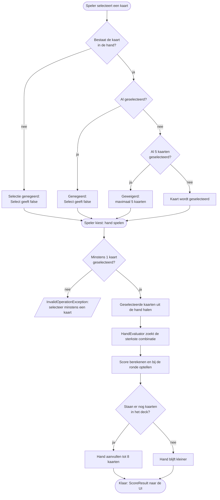
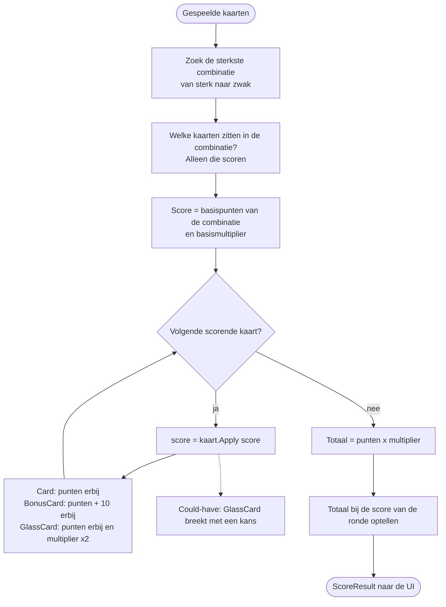

# Flowcharts

GitHub tekent deze diagrammen automatisch (Mermaid).

## 1. Hand validity check (een hand spelen)

Wat er gebeurt vanaf het selecteren van kaarten tot de score. Dit is hoe de code nu werkt
(`Hand.Select`, `Round.PlayHand`, `HandEvaluator.Evaluate`).

## 2. Scoring met speciale kaarten

Dit is hoe `ScoreCalculator` werkt. Het enige wat de calculator van een kaart weet is `ICard.Apply(Score)`:
de kaart krijgt de huidige score en geeft een nieuwe terug. Het breken van een GlassCard is een could-have en
is **niet gebouwd** (de stippellijn).

Zo wordt gescoord: `(basispunten + kaartpunten) x multiplier`, waarbij een GlassCard de multiplier verdubbelt.
