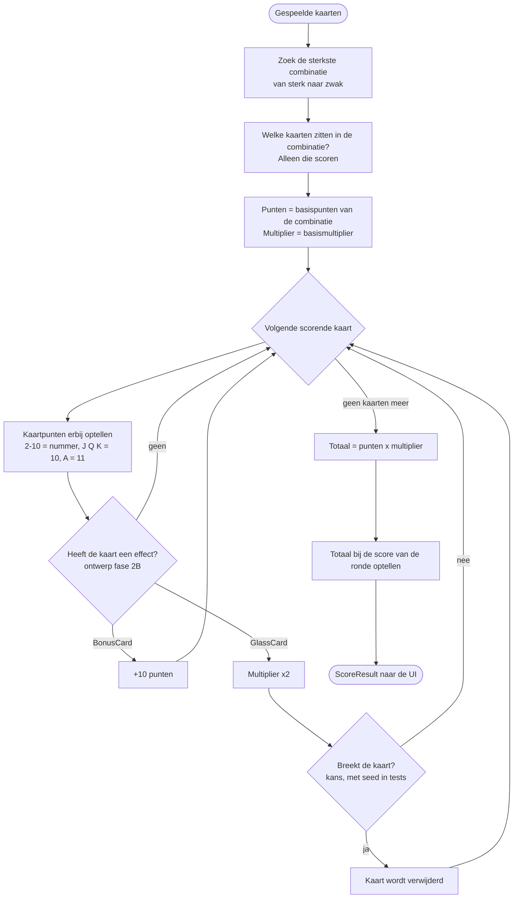

# Flowcharts

GitHub tekent deze diagrammen automatisch (Mermaid).

## 1. Hand validity check (een hand spelen)

Wat er gebeurt vanaf het selecteren van kaarten tot de score. Dit is hoe de code nu werkt
(`Hand.Select`, `Round.PlayHand`, `HandEvaluator.Evaluate`).

## 2. Scoring met alle speciale kaarten (ontwerp voor fase 2B)

De basisscore (combinatie zoeken, kaartpunten, totaal) werkt al. De stappen over speciale kaarten (BonusCard,
GlassCard) zijn het **ontwerp voor fase 2B** en zijn nog niet gebouwd.

Zo wordt gescoord: `(basispunten + kaartpunten) x multiplier`.
