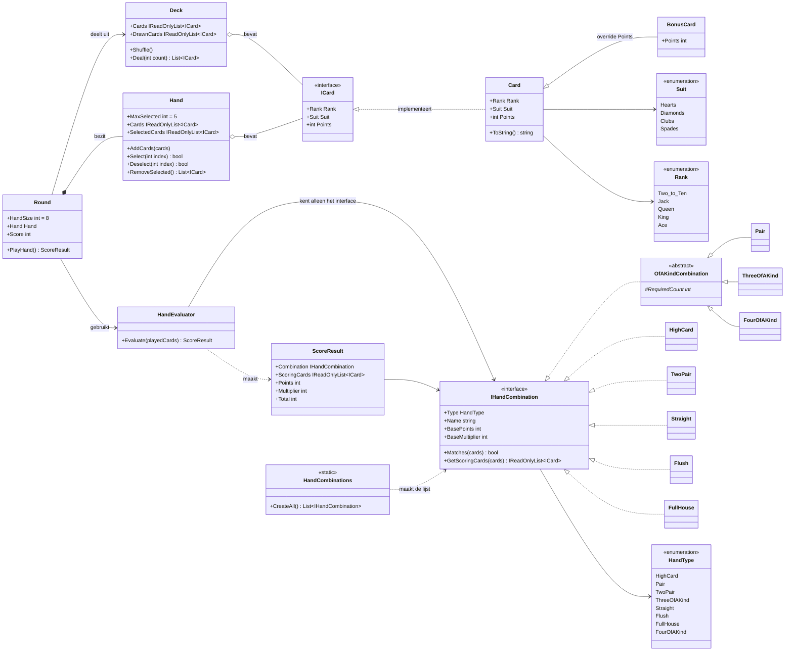

# Klassendiagram (UML)

Dit diagram toont de klassen van `BalatroConsole` en hoe ze samenhangen. GitHub tekent het
automatisch (Mermaid). In Visual Studio kun je de tekst plakken op https://mermaid.live.

## Waarom zo?

| Keuze | Reden |
|---|---|
| `IHandCombination` (interface) | `HandEvaluator` kent alleen het interface. Een nieuwe combinatie is een nieuwe klasse plus een regel in `HandCombinations`, zonder `switch` aan te passen. |
| `OfAKindCombination` (abstract) | Pair, Three of a kind en Four of a kind zoeken allemaal "N kaarten met dezelfde rank". Die code staat een keer, de kinderen geven alleen `RequiredCount` en hun scorewaarden. |
| `HighCard`, `TwoPair`, `Straight`, `Flush` en `FullHouse` implementeren het interface direct | Ze passen niet bij "een rank, N kaarten" (twee groepen, een reeks, een suit), dus erven ze niet van de abstracte klasse. |
| `ICard` los van `Card` | Kaartvarianten (BonusCard, GlassCard, ...) in fase 2B kunnen het interface implementeren zonder dat de score-logica verandert. |
| `ScoreResult` onveranderlijk | Het resultaat van een gespeelde hand verandert niet meer, dus de UI kan het veilig tonen. |
| `Models` en `Logic` kennen de UI niet | Logica en visualisatie zijn gescheiden: de console-UI (en later WinForms) kan dezelfde klassen gebruiken. |
